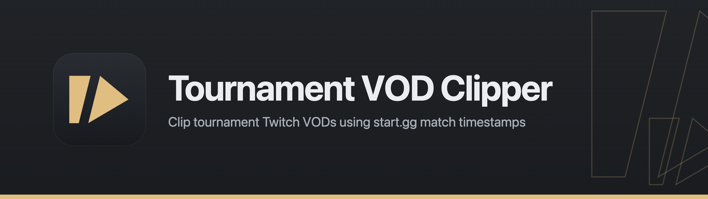
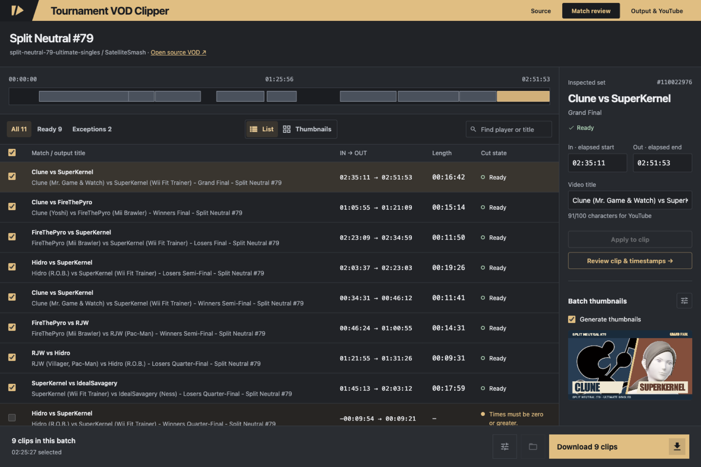
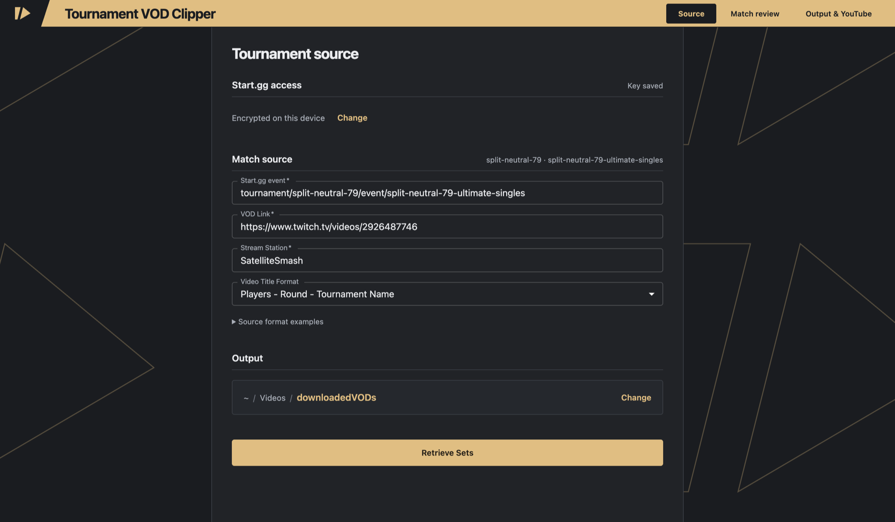
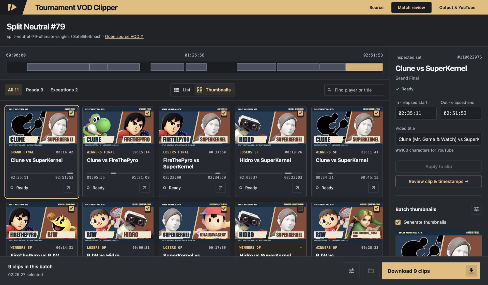
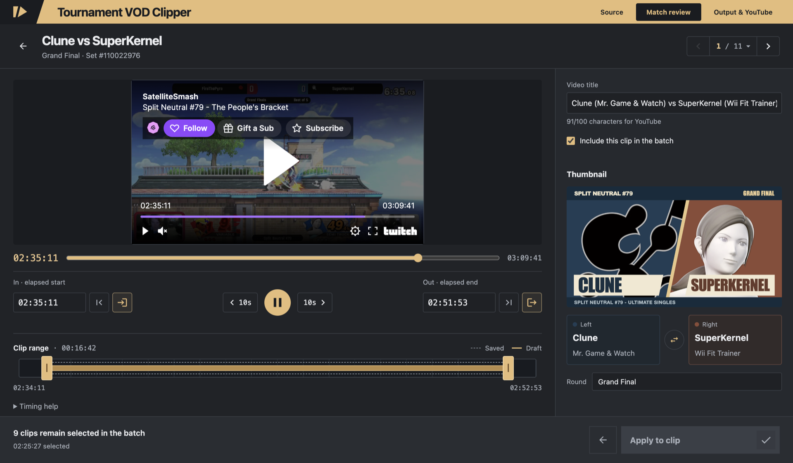

This React and Electron app clips tournament VODs automatically. It is a work in progress and has bugs. To report an issue or suggest a change, [open an issue](https://github.com/willie-yao/tournament-vod-clipper/issues).

## Main Features

- Automatically clips Twitch VODs of matches from a start.gg bracket
- Clips selected matches one at a time and reports partial failures
- Generates thumbnails for each match
- Uploads VODs to YouTube automatically

## Requirements

- Windows x64 or macOS Apple Silicon. Linux and Intel Macs are not supported.
- A [start.gg API token](https://start.gg/admin/profile/developer) and a Twitch VOD link.
- A YouTube account, to upload.

The app bundles yt-dlp and FFmpeg, so you install nothing else. It does not update itself. Download each new release from the releases page.

## Prerequisites

The app clips VODs from the timestamps of when matches start and are reported on Start.GG. For accurate clips, you need to do the following:

1. Assign stream sets to a stream setup. See the [Start.GG documentation](https://help.start.gg/en/articles/1465692-adding-streams-and-creating-stations).
2. Start the stream match exactly when you want the VOD for that match to start. Report the match exactly when you want the VOD to end. If you do this incorrectly, the VOD starts or ends at the wrong time, but you can edit the times.
3. To show characters in the video title and thumbnails, report characters for the match.

## How to Use

### Download

1. Download the latest release from the [releases page](https://github.com/willie-yao/tournament-vod-clipper/releases).
2. Extract the zip file to a folder of your choice.
3. Run `tournament-vod-clipper.exe`.

### Retrieve streamed sets

1. Create a personal API token in your [start.gg developer settings](https://start.gg/admin/profile/developer), enter it in `Start.gg API key`, and click `Save API Key`. The app keeps the key across restarts. Click `Change` to replace or remove it.
2. Choose the event in `Start.gg event`. Focus the field to pick from tournaments you recently organized or competed in. Type at least three letters to search by name. Paste a tournament link to list its events. You can also paste an event link or slug, such as:
   - https://www.start.gg/tournament/microspacing-69/event/singles-de
   - tournament/microspacing-69/event/singles-de
3. Enter the Twitch VOD link in `VOD Link`, for example https://www.twitch.tv/videos/123456789. The field accepts links without `https://`.
4. To retrieve only the streamed sets, enter the Twitch channel name or a station number in `Stream Station`.
5. Click `Retrieve Sets` to load Match review. Click `Cancel retrieval` to stop and retry. A timeout leaves your fields intact and shows an error. See [How it works](docs/how-it-works.md#retrieval-limits) for the time limits.

### Download sets

- Click a match name, title or thumbnail to inspect it. Click the inspected match again to open clip and timestamp review. Inspecting does not select the match.
- Check individual clips, or the header checkbox, to select valid ranges. `List` and `Thumbnails` share titles, selection, drafts and download progress.
- Edit and apply a title to override the suggestion. Titles over YouTube's 100-character limit are shortened automatically; custom titles are validated, never shortened. See [How it works](docs/how-it-works.md#generated-titles).
- Choose `Review clip & timestamps` to play the VOD in Twitch, seek, and set In and Out from the playhead. Drag the range handles, or focus them and press Arrow keys to move one second. The dashed range shows saved boundaries and the solid range shows the draft. Click Apply before downloading.
- Times are elapsed `HH:mm:ss` from the start of the VOD, so `25:00:00` means 25 hours. Incomplete matches and ranges before the VOD appear under Exceptions. Enter valid boundaries, apply the correction, then select the clip.
- Start.gg times are suggestions. Verify them against the VOD. Cuts are not frame-accurate.
- Thumbnails use the Offset Duel design: opposing portraits, slanted nameplates, a tournament and round header, and an event footer. A missing character pick shows a question mark. Previews and 1280x720 JPEG exports share one renderer.
- `Thumbnail & output options` applies to the whole batch. Left and right field colors are independent. A custom background image sits behind both portraits and a custom logo appears in the header.
- `Output folder` defaults to the existing `downloadedVODs` location. Click `Choose Output Folder` to use another writable folder. Choose your old `downloadedVODs` folder to reach earlier clips.
- Click `Download N clips` to save the selected matches and thumbnails. The app never overwrites or renames existing files. If a name is in use, choose another title. `Retry incomplete clips` resumes confirmed video progress. `Continue to Upload` appears when all selected outputs are ready.

### Upload to YouTube

1. Click `Upload`.
2. Click `Connect YouTube` and approve access in your system browser. Confirm the displayed channel before uploading.
3. Select the tournament in `VOD Folder`.
4. Set the visibility and description for all of the videos.
5. Review each title (1 to 100 characters), then click `Upload`. Videos upload one at a time. The screen separates confirmed videos from thumbnail and playlist failures.
6. If access expires or is revoked, click `Reconnect YouTube`, then `Retry Failed Steps`. Confirmed videos are not uploaded again. After an app restart, a reload or an unconfirmed request, check your YouTube channel and playlist before you retry.

## More documentation

- [How it works](docs/how-it-works.md): retrieval limits, title shortening, thumbnails and the preview server.
- [Development](docs/development.md): build, test, native tools, packaging and Google OAuth setup.
- [Privacy and terms](PRIVACY.md): what the app stores and sends, and how to disconnect or revoke access.
